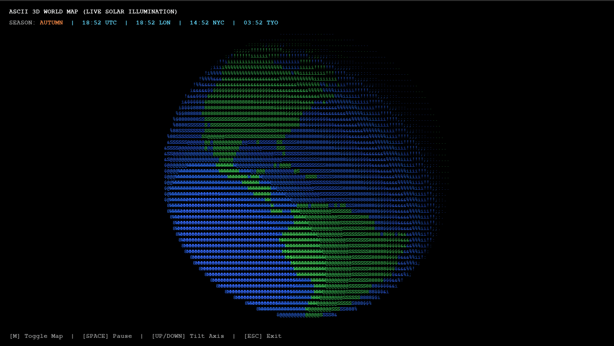

# ASCII 3D World Map with live solar illumination

An ASCII-rendered 3D rotating globe built in Python using Pygame and NumPy. It features real-time solar tracking, seasonal tilt variations, land/ocean shading, and live world clocks.



---

## Requirements
Make sure you have Python 3 and the required packages installed:

```bash
pip install pygame numpy
```

## Run it yourself

```bash
python ascii_earth.py
```
